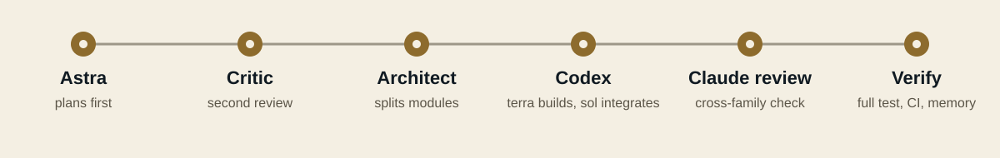

<p align="center"></p>

<h1 align="center"><picture><source media="(prefers-color-scheme: dark)" srcset="https://raw.githubusercontent.com/xinhi6716/xinhi6716/443d48c713f27d52656ad8ea3cb4c5bb9c7dd440/assets/brand-marks/v1/chronos-icon-dark.svg"></picture> Axiom Chronos</h1>

<p align="center"><strong>Plan, build and review code changes with Claude and Codex.</strong></p>

<p align="center"><strong>English</strong> · <a href="README.zh-TW.md">繁體中文</a></p>

<p align="center"><a href="docs/releases/2.0.0.md">Release 2.0.0</a></p>

<p align="center"><a href="#begin">Quick start</a> · <a href="#desktop-app">Desktop app</a> · <a href="#the-work">Workflow</a> · <a href="#record-review">Records</a> · <a href="#status">Status</a></p>

Make a wish on your codebase. Chronos plans it, splits it into modules, has Codex build them, has Claude review them, and keeps working until the change is verified or blocked.

**Review each diff before committing.**

<a id="begin"></a>
<a id="install"></a>

## Start

Download an install package from [Releases](https://github.com/xinhi6716/axiom-chronos/releases) and extract it. You need [Claude Code](https://claude.com/claude-code) and the Codex CLI, both signed in.

Windows x64: `axiom-chronos-2.0.0-windows-x64.zip`. In the extracted folder, run:

```powershell
powershell -NoProfile -ExecutionPolicy Bypass -File .\install.ps1
```

Linux x64: `axiom-chronos-2.0.0-linux-x64.tar.gz`. In the extracted folder, run:

```sh
sh ./install.sh
```

Windows installs both programs to `%LOCALAPPDATA%\Programs\Axiom Chronos`, adds the user PATH and a Start menu shortcut, and upgrades 1.0.0 in place; close both programs first. Use `-Prefix DIR`, `-NoPath`, `-NoShortcut` or `-NoPlugin` to change that. Linux installs `axiom` to `~/.local/bin` (add it to PATH if needed); use `--prefix DIR` or `--no-plugin`. Both installers add or update the Claude `chronos` plugin when `claude` is available, then print `axiom doctor`; health-check problems do not fail installation. Windows includes `uninstall.ps1`; it leaves `~/.axiom` and the Claude plugin alone. Bare binaries remain available.

Or build it with Rust:

```sh
cargo install --git https://github.com/xinhi6716/axiom-chronos --tag v2.0.0 --locked --bin axiom
axiom doctor
```

In a project whose tests you can run:

```sh
axiom wish add a --stats flag to cli.py that prints done/total
```

Inside Claude Code, use `/chronos:wish` with the same text.

**Save a checkpoint first.** A wish edits files and sends project material to your signed-in model services.

<a id="desktop-app"></a>

## Desktop app

The Windows-only desktop app lets you make a wish, watch it and steer it without a terminal. Start it with `chronos` or the Start menu shortcut. Builds with the `app` feature also accept `axiom app`. To build the desktop program yourself, run `cargo install --git https://github.com/xinhi6716/axiom-chronos --tag v2.0.0 --locked --features app --bin chronos`. The bottom strip hides quota windows absent from fresh plan snapshots and shows live per-model concurrency with celestial vector glyphs; Mini falls back to the parallel total when space is short.

The main screens are **Run** (a checklist of goals, modules and units, a live graph of the run, and the brief, report, verify output and review of each unit), **Wishes** (past and running wishes, and which one needs you), **Memory** (what Chronos remembers; correct or delete an entry), **Usage** (tokens and cost per run) and **Settings** (language, theme, health check). Ctrl+N makes a new wish and Ctrl+K searches everything. A wish started in a terminal shows up there too, view only.

A remaining-quota strip shows Claude and Codex, with an hourglass for each quota window. Use the mini window with optional always-on-top, focus mode, and comfortable or dense spacing. Right-click menus, undo, tooltips and keyboard access cover the controls; `?` lists the keys.

The summary board uses Codex luna, falling back to Claude Haiku, to describe each run; you can select Haiku or turn summaries off. Counts and states come from recorded data. A Haiku narrator writes the final report, and an optional plain-words translation makes technical text easier to read. These model calls use your services' quota. Usage shows tokens per model and API-price equivalents, including Codex at the official API rates recorded in the release, rather than subscription charges. The **Auto-evolve** button previews recent problems and asks before starting a change.

<a id="the-work"></a>
<a id="how-a-wish-runs"></a>
<a id="use"></a>

## How a wish runs

<p align="center"><picture>
  <source media="(prefers-color-scheme: dark) and (max-width: 600px)" srcset="assets/chronos-process-dark-mobile.svg" />
  <source media="(max-width: 600px)" srcset="assets/chronos-process-mobile.svg" />
  <source media="(prefers-color-scheme: dark)" srcset="assets/chronos-process-dark.svg" />
  
</picture></p>

Every wish starts with Astra: Astra plans the change, `chronos:critic` reviews the plan, and the core rules on it before any unit is built.

The architect splits the work into modules with contracts and acceptance tests. The dispatcher sends each unit to a Codex `terra` worker; `sol` steps in only when the full suite fails after several units changed files.

`AXIOM_CODEX_MAX_PARALLEL` caps Chronos Codex turns across processes sharing the data home (default 48); full pools wait and remain cancellable. Settings saves the cap for app wishes, and the quota strip and `axiom doctor` show slots in use. Codex runs you start yourself are excluded.

Claude (`chronos:reviewer`, `chronos:critic`) reviews the Codex work; a Haiku narrator writes the final report from the engine digest and the core's rulings.

The binary enforces the gates: no write without a claimed unit, no verified unit without a passing review of the exact files, no finished goal without a current full test.

Reviewers write their own verdict files using a blocker/major/minor rubric. Reports list findings that need smoke or manual checks. Review results carry forward across sibling fixes (`AXIOM_REVIEW_CARRY=0` disables this); a fix chain stops after two rounds for the core to rule on findings with `orch waive` and a reason, or block the wish.

Questions are asked only at the start. While it runs you keep interjection: in `axiom wish`, type a line and press Enter to add instructions, ask, or stop.

When what remains is a long batch of the project's own programs, the wish waits on it with no model running and continues when the batch ends. `axiom wish` does this by itself; `axiom wait <session-id>` picks up a wish that is waiting, for example after Ctrl-C.

| Option | Purpose |
|---|---|
| `--project PATH` | Work on another project. |
| `--resume <session-id> [message]` | Continue a stopped or blocked wish; the message, if given, is its first turn. |
| `--creative` | Let Chronos find one small, evidence-backed improvement. |
| `--max-turns N` | Limit core-session turns. |
| `--advanced-research` | Opt in to the paid research council before planning. |
| `--fable-cap USD`, `--astra-cap TOKENS`, `--council-rounds N` | Override council budgets; require `--advanced-research`. |

Put options **before** the wish; everything after them is wish text. `axiom research` turns a question into a reviewed research plan.

More commands: `axiom review <git range>` gives a diff a second opinion from another model family (Codex first, with agy as an optional backup that never blocks; `--diff-only` sends just the diff), `axiom lint` checks a project's memory for stale or duplicate entries and broken quotes, and `axiom usage` prints a per-run ledger of tokens and cost.

`axiom evolve --dry-run` gives a self-improvement digest from Chronos's own logs for the last seven days. Review it before explicitly running `axiom evolve --repo PATH` against the Chronos source repository. It is an on-demand weekly pass, not a scheduled job: the desktop asks for confirmation; the CLI start command has no confirmation prompt.

**Optional pieces.** agy (the backup reviewer) and [CodeGraph](https://github.com/colbymchenry/codegraph) (less code reading when a `.codegraph/` folder exists) are used only if installed. `--advanced-research` is the one option that costs extra: Astra and Fable discuss the plan in order (Astra first each round); Argon (Gemini 4) reviews exactly once afterward. If Argon objects, Astra and Fable answer in the same order; the core rules with every phase recorded. It is off unless you ask. Defaults are Fable $5, Astra 200k tokens, Argon 400k tokens for one review, and up to 3 rounds in each dialogue phase. Set `AXIOM_FABLE_CAP_USD`, `AXIOM_ASTRA_TOKEN_CAP`, `AXIOM_ARGON_TOKEN_CAP` and `AXIOM_COUNCIL_ROUNDS`, or use Settings → Advanced research budgets. CLI overrides: `axiom wish --advanced-research --fable-cap 20 --astra-cap 600000 --council-rounds 3 "fix the bug"`. These options require `--advanced-research`. Values must be positive; tokens and rounds must be whole numbers. Invalid values refuse startup; a Fable cap above $200 is refused as probably a typo. Agreement stops a phase early; spent budgets, failures or its round cap leave disputes for the core. Argon failure ends after the planning dialogue and is reported as not reviewed.

To save tokens, each module gets its own dispatcher, with a soft warning at 80% of the handoff limit and a fresh dispatcher at 150k tokens. Binding rules are restored verbatim after compaction; rarely used prompt sections load only when needed. Handoff notes are checked for instructions to hide problems. The no-progress guard stops a wish after three unchanged continuations instead of re-prompting it (`AXIOM_IDLE_CONTINUES` changes the count).

When Claude reports a usage limit with a reset time, `axiom wish` prints when it will continue, waits for the reset and resumes the same session by itself; Ctrl-C stops the wait.

<a id="record-review"></a>
<a id="state--review"></a>

## Records

State lives in `~/.axiom` (set `AXIOM_HOME` to move it): work records and briefs in `orchestrate/`, searchable memory in `memory/`, raw session events in `logs/`. They may contain project material; inspect them before sharing.

<a id="horizon"></a>
<a id="status"></a>

## Status

Available: `chronos` (Windows desktop app), `axiom wish`, `axiom wait`, `axiom research`, `axiom review`, `axiom lint`, `axiom usage`, `axiom evolve`, `axiom doctor`. Tests run the protocols against scripted stand-ins for Claude and Codex; live-model results vary by project.

**Known limits.** Agent definitions set `autoCompactWindow`, but its effect has not yet been observed in a real run. The handoff-note guard has not yet been seen working in a real run either; it uses a pattern list and can miss paraphrases. Unit states come from evidence, not notes. The desktop app is Windows only.

[Bridge reference](docs/bridge.md) · [Dispatch policy](engine/DISPATCH.md) · [Wish workflow](engine/skills/wish/SKILL.md) · [Release notes](docs/releases/2.0.0.md) · [Changelog](CHANGELOG.md) · [Desktop app design](docs/app-design.md)

---

[MIT License](LICENSE) · [Credits and licenses](licenses/) · [Asset notices](assets/ASSET_NOTICES.txt)
