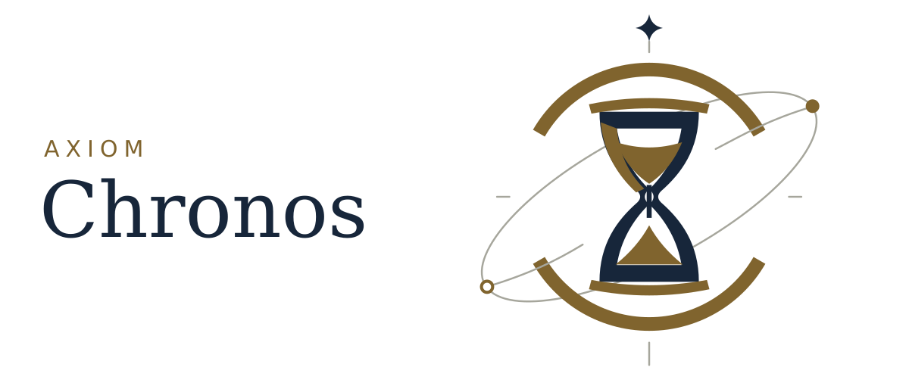
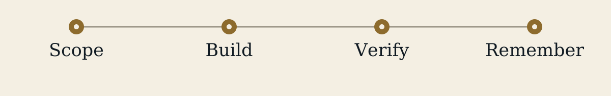

<p align="center"><picture>
  <source media="(prefers-color-scheme: dark) and (max-width: 600px)" srcset="assets/readme-cover-dark-mobile.svg" />
  <source media="(max-width: 600px)" srcset="assets/readme-cover-mobile.svg" />
  <source media="(prefers-color-scheme: dark)" srcset="assets/readme-cover-dark.svg" />
  
</picture></p>

<h1 align="center">Axiom Chronos</h1>

<p align="center"><a href="README.md">English</a> · <a href="README.zh-TW.md">繁體中文</a></p>

<p align="center"><a href="#begin">Start</a> · <a href="#the-work">Use</a> · <a href="#status">Status</a></p>

Coordinate scoped code changes with Claude Code and Codex. Keep verification records and reusable project context.

**Public beta · 0.2.0-beta.1.** Review each diff before committing.

| 01 · Prepare | 02 · Describe | 03 · Review |
| --- | --- | --- |
| Check the environment with `axiom doctor`. | Give `axiom wish` one concrete change. | Inspect the diff and verification record. |

<a id="begin"></a>
<a id="install"></a>

## Start

You need [Claude Code](https://claude.com/claude-code) and the Codex CLI. Sign in to `claude` and `codex` first. Download the single `axiom` binary, or build and install it with Rust:

```sh
cargo install --git https://github.com/xinhi6716/axiom-chronos --locked
axiom doctor
```

From a project whose tests you can run:

```sh
axiom wish add a --stats flag to cli.py that prints done/total
```

**Save a checkpoint first.** A wish can edit files and call your signed-in model services. Use only project material you are allowed to share with those services.

<details>
<summary><strong>Setup details</strong></summary>

`axiom doctor` checks tools, SQLite support and the state directory; it does not run a wish. SQLite needs FTS5 and JSON.

Antigravity (`agy`) is optional. If its Gemini preview fails, the core can show the dispatcher report.

On Windows, doctor flags Microsoft Store PowerShell because Codex cannot use it to run worker commands. Use the MSI build as described in the [bridge notes](docs/bridge.md).

</details>

<a id="the-work"></a>
<a id="how-a-wish-runs"></a>
<a id="use"></a>

## How to use it

Describe one concrete change. The dispatcher writes a `GOAL · SCOPE · VERIFY` brief, sends it to a Codex worker, then checks the command record or runs VERIFY. Its instructions require it to ask first about unresolved interface or data choices.

Put CLI options **before** the wish. Everything after them is wish text, including flag names.

For interjection, press Esc in interactive mode. In `axiom wish`, type a line and press Enter to send it into the running session: amend instructions, answer a question, or stop. Use `axiom research` for research.

```sh
axiom wish --project ../other rename calc to compute_total everywhere
```

`axiom wish --resume <session-id>` resumes a session; `axiom wish --creative` starts creative exploration.

<details>
<summary><strong>Options and roles</strong></summary>

| Option | Default | Purpose |
|---|---|---|
| `--project PATH` | Current directory | Choose the project. |
| `--max-turns N` | — | Limit core-session turns. |
| `--resume <session-id>` | — | Resume a previous wish session. |
| `--creative` | — | Explore and select a small evidence-backed increment. |

- **Claude Code core:** reads project history, delegates the wish and checks the final explanation against reported facts.
- **Sonnet dispatcher:** scopes units, supplies relevant memory and verifies their command records.
- **Codex `terra` workers:** work in ephemeral threads. A `sol` integration unit is used only when the full suite fails after more than one unit changed files.
- **Optional Gemini via `agy`:** rewrites reports in plain language.
- **Haiku memory keeper:** saves reusable work from verified units.

Claude sessions load the engine with local settings. Codex workers use lean mode by default, requesting that unrelated plugins, MCP servers, apps and skills context be disabled for that thread. [Bridge contracts](docs/bridge.md#contracts).

<p align="center"><picture>
  <source media="(prefers-color-scheme: dark) and (max-width: 600px)" srcset="assets/chronos-process-dark-mobile.svg" />
  <source media="(max-width: 600px)" srcset="assets/chronos-process-mobile.svg" />
  <source media="(prefers-color-scheme: dark)" srcset="assets/chronos-process-dark.svg" />
  
</picture></p>

This diagram describes the intended beta workflow, not an enforced correctness guarantee.

</details>

<a id="record-review"></a>
<a id="state--review"></a>

## Review and keep the record

Read the diff, inspect what VERIFY actually ran and resolve any failed units or open questions. A completed model session does not establish a correct change.

State lives in `~/.axiom`; set `AXIOM_HOME` to use another location.

<details>
<summary><strong>Stored records and privacy</strong></summary>

```text
~/.axiom/
├── orchestrate/   Work records, briefs and raw reports
├── memory/        Searchable memory and project-history summaries
└── logs/          Raw session events, one log per run
```

Memory retains the wish and hashes of referenced files so later lookups can flag stale content. Logs, memory and reports may contain project material. Inspect them before sharing.

</details>

<a id="horizon"></a>
<a id="status"></a>

## Current status

**Available:** `axiom wish`, `axiom research` and `axiom doctor`. Commands, state and agent behavior may change during beta.

**Planned:** `ask`, `review`, `catchup`, `evolve`, and stage-specific [Atropos](https://github.com/xinhi6716/axiom-atropos) skill integration. These are not shipped beta features.

Tests use scripted stand-ins for Claude, Codex and `agy`; they check protocols and local behavior. The initial project report covers small-project Codex runs only. Neither establishes live-model performance or full end-to-end reliability.

[Bridge reference](docs/bridge.md) · [Dispatch policy](engine/DISPATCH.md) · [Wish workflow](engine/skills/wish/SKILL.md) · [Tests](tests/)

---

[MIT License](LICENSE) · [Credits and licenses](licenses/) · [Asset notices](assets/ASSET_NOTICES.txt)

Work tracking reimplements poteto’s [Pstack](https://github.com/cursor/plugins/tree/main/pstack) `orch` in Rust, in process. The visual identity is original Axiom Celestial Order artwork.
