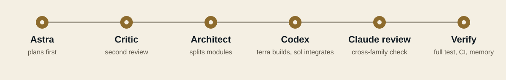

<p align="center"></p>

<h1 align="center">Axiom Chronos</h1>

<p align="center"><a href="README.md">English</a> · <a href="README.zh-TW.md">繁體中文</a></p>

<p align="center"><a href="#begin">開始</a> · <a href="#the-work">使用</a> · <a href="#status">狀態</a></p>

對你的程式碼許一個願望。Chronos 會先規劃、切成模組、交給 Codex 施工、由 Claude 審查，一直做到修改驗證完成或確定卡住為止。

**正式版 · 1.0.0。** 每次 commit 前請檢查 diff。

<a id="begin"></a>
<a id="install"></a>
<a id="安裝"></a>

## 開始

需要 [Claude Code](https://claude.com/claude-code) 與 Codex CLI，兩者都要先登入。從 [Releases](https://github.com/xinhi6716/axiom-chronos/releases) 下載 `axiom`，或用 Rust 建置：

```sh
cargo install --git https://github.com/xinhi6716/axiom-chronos --locked
axiom doctor
```

在你能執行測試的專案目錄中：

```sh
axiom wish 在 cli.py 加一個 --stats 參數，印出 已完成/總數
```

在 Claude Code 裡，用 `/chronos:wish` 加上同樣的文字。

**先保留版本檢查點。** 願望會修改檔案，並把專案資料送到你已登入的模型服務。

<a id="the-work"></a>
<a id="how-a-wish-runs"></a>
<a id="一個願望怎麼跑"></a>
<a id="use"></a>
<a id="使用"></a>

## 一個願望怎麼跑

<p align="center"><picture>
  <source media="(prefers-color-scheme: dark) and (max-width: 600px)" srcset="assets/chronos-process-dark-mobile.svg" />
  <source media="(max-width: 600px)" srcset="assets/chronos-process-mobile.svg" />
  <source media="(prefers-color-scheme: dark)" srcset="assets/chronos-process-dark.svg" />
  
</picture></p>

每次 wish 都先由 Astra 規劃，`chronos:critic` 審查計畫，核心裁決後才開始建置。

architect 把工作切成模組，每個模組有介面規格與驗收測試。調度代理把每個單元交給 Codex `terra` 實作；只有多個單元改檔後完整測試失敗時，才由 `sol` 整合。

審查由 Claude（`chronos:reviewer`、`chronos:critic`）負責審 Codex 的成果；最後報告由核心直接以白話撰寫。

關卡由執行檔強制：沒有占用單元不能寫檔、審查沒通過那份檔案的單元不算驗收、沒有最新的完整測試不能結案。

只在開頭提問。執行中你保有插話權（interjection）：在 `axiom wish` 輸入一行並按 Enter，就能追加指示、提問或喊停。

| 選項 | 用途 |
|---|---|
| `--project PATH` | 處理另一個專案。 |
| `--resume <session-id>` | 接續中斷或卡住的願望。 |
| `--creative` | 讓 Chronos 自己找一個有證據支持的小改進。 |
| `--max-turns N` | 限制核心 session 回合數。 |

選項放在願望**前面**，後面的文字都是願望內容。`axiom research` 會把問題變成審查過的研究計畫。

<a id="record-review"></a>
<a id="state--review"></a>
<a id="狀態與檢查"></a>

## 紀錄

狀態存在 `~/.axiom`（可用 `AXIOM_HOME` 改位置）：`orchestrate/` 放工作紀錄與 brief，`memory/` 放可搜尋的記憶，`logs/` 放原始 session 事件。這些可能含有專案資料，分享前請先檢查。

<a id="horizon"></a>
<a id="status"></a>
<a id="進度"></a>

## 狀態

目前提供：`axiom wish`、`axiom research`、`axiom doctor`。測試用腳本替身模擬 Claude 與 Codex 來檢查協定；真實模型的表現依專案而異。

[Bridge 技術文件](docs/bridge.md) · [派工規則](engine/DISPATCH.md) · [Wish 流程](engine/skills/wish/SKILL.md) · [版本說明](docs/releases/1.0.0.md)

---

[MIT 授權](LICENSE) · [來源與授權](licenses/) · [素材聲明](assets/ASSET_NOTICES.txt)
