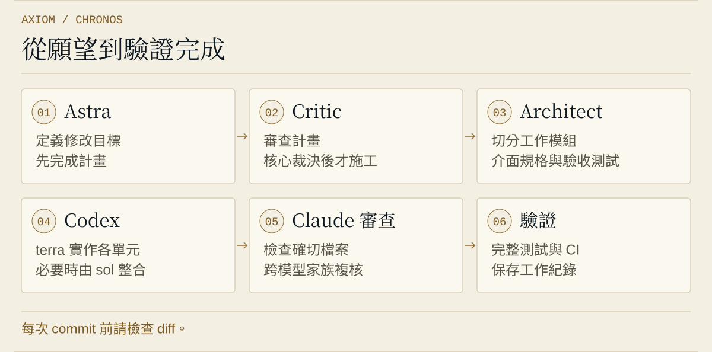

<p align="center"></p>

<h1 align="center"><picture><source media="(prefers-color-scheme: dark)" srcset="https://raw.githubusercontent.com/xinhi6716/xinhi6716/443d48c713f27d52656ad8ea3cb4c5bb9c7dd440/assets/brand-marks/v1/chronos-icon-dark.svg"></picture> Axiom Chronos</h1>

<p align="center"><strong>讓 Claude 與 Codex 一起規劃、實作與審查程式修改。</strong></p>

<p align="center"><a href="README.md">English</a> · <strong>繁體中文</strong></p>

<p align="center"><a href="docs/releases/2.0.0.md">版本 2.0.0</a></p>

<p align="center"><a href="#begin">開始</a> · <a href="#desktop-app">桌面應用程式</a> · <a href="#the-work">工作流程</a> · <a href="#record-review">紀錄</a> · <a href="#status">狀態</a></p>

對你的程式碼許一個願望。Chronos 會先規劃、切成模組、交給 Codex 施工、由 Claude 審查，一直做到修改驗證完成或確定卡住為止。

**每次 commit 前請檢查 diff。**

<a id="begin"></a>
<a id="install"></a>
<a id="安裝"></a>

## 開始

從 [Releases](https://github.com/xinhi6716/axiom-chronos/releases) 下載安裝包並解壓縮。需要 [Claude Code](https://claude.com/claude-code) 與 Codex CLI，兩者都要先登入。

Windows x64：`axiom-chronos-2.0.0-windows-x64.zip`。在解壓後的資料夾執行：

```powershell
powershell -NoProfile -ExecutionPolicy Bypass -File .\install.ps1
```

Linux x64：`axiom-chronos-2.0.0-linux-x64.tar.gz`。在解壓後的資料夾執行：

```sh
sh ./install.sh
```

Windows 把兩個程式裝到 `%LOCALAPPDATA%\Programs\Axiom Chronos`、加入使用者 PATH 與開始功能表捷徑，可原地升級 1.0.0；升級前請先關閉兩個程式。可用 `-Prefix DIR`、`-NoPath`、`-NoShortcut` 或 `-NoPlugin` 調整。Linux 把 `axiom` 裝到 `~/.local/bin`（需要時自行加入 PATH），可用 `--prefix DIR` 或 `--no-plugin`。兩者在找到 `claude` 時會加入或更新 Claude 的 `chronos` 插件，最後印出 `axiom doctor` 結果；健康檢查有問題不會判定安裝失敗。Windows 附有 `uninstall.ps1`，解除安裝會保留 `~/.axiom` 與 Claude 插件。裸執行檔仍可下載。

或用 Rust 建置：

```sh
cargo install --git https://github.com/xinhi6716/axiom-chronos --tag v2.0.0 --locked --bin axiom
axiom doctor
```

在你能執行測試的專案目錄中：

```sh
axiom wish 在 cli.py 加一個 --stats 參數，印出 已完成/總數
```

在 Claude Code 裡，用 `/chronos:wish` 加上同樣的文字。

**先保留版本檢查點。** 願望會修改檔案，並把專案資料送到你已登入的模型服務。

<a id="desktop-app"></a>

## 桌面應用程式

桌面應用程式僅支援 Windows，不用開終端機就能許願、觀看並調整進行中的工作。用 `chronos` 或開始功能表捷徑啟動。啟用 `app` feature 的建置也能執行 `axiom app`。想自行建置桌面程式，可執行 `cargo install --git https://github.com/xinhi6716/axiom-chronos --tag v2.0.0 --locked --features app --bin chronos`。 底欄隱藏新鮮方案快照未提供的額度視窗，並以天體向量圖符顯示各模型即時並行數；迷你視窗空間不足時只顯示並行總數。

主要畫面：**Run**（目標、模組、單元的待辦清單，即時的執行圖，以及每個單元的 brief、報告、驗證輸出與審查）、**Wishes**（過去與進行中的願望，哪一個需要你處理）、**Memory**（Chronos 記得什麼，可更正或刪除條目）、**Usage**（每次執行的 token 與費用）、**Settings**（語言、主題、健康檢查）。Ctrl+N 新增願望、Ctrl+K 搜尋全部。在終端機啟動的願望也會出現在這裡，但只能檢視。

剩餘額度列顯示 Claude 與 Codex，每個額度時窗各有一個沙漏。可用迷你視窗並選擇保持最上層、聚焦模式，以及舒適或緊湊間距。控制項支援右鍵選單、復原、提示與鍵盤操作；按 `?` 查看按鍵。

摘要看板用 Codex luna 描述每次執行，失敗時改用 Claude Haiku；也可指定 Haiku 或關閉摘要。數量與狀態直接取自紀錄。Haiku 敘述員撰寫最終報告，選用的白話翻譯讓技術文字更易讀。這些模型呼叫會使用你服務的額度。Usage 顯示各模型的 token 與 API 定價等值金額，Codex 採本版記錄的官方 API 費率，並非訂閱帳單。**自動演進**按鈕會預覽近期問題，確認後才開始修改。

<a id="the-work"></a>
<a id="how-a-wish-runs"></a>
<a id="一個願望怎麼跑"></a>
<a id="use"></a>
<a id="使用"></a>

## 一個願望怎麼跑

<p align="center"><picture>
  <source media="(prefers-color-scheme: dark) and (max-width: 600px)" srcset="assets/chronos-process-zh-TW-dark-mobile.svg" />
  <source media="(max-width: 600px)" srcset="assets/chronos-process-zh-TW-mobile.svg" />
  <source media="(prefers-color-scheme: dark)" srcset="assets/chronos-process-zh-TW-dark.svg" />
  
</picture></p>

每次 wish 都先由 Astra 規劃，`chronos:critic` 審查計畫，核心裁決後才開始建置。

architect 把工作切成模組，每個模組有介面規格與驗收測試。調度代理把每個單元交給 Codex `terra` 實作；只有多個單元改檔後完整測試失敗時，才由 `sol` 整合。

`AXIOM_CODEX_MAX_PARALLEL` 限制共用資料目錄的 Chronos 程序之 Codex 並行回合，預設 48；滿額時等待且仍可取消。設定可儲存桌面許願的上限，額度列與 `axiom doctor` 顯示使用槽數；不計入你自行啟動的 Codex。

審查由 Claude（`chronos:reviewer`、`chronos:critic`）負責審 Codex 的成果；Haiku 敘述員依引擎摘要與核心裁決撰寫最終報告。

關卡由執行檔強制：沒有占用單元不能寫檔、審查沒通過那份檔案的單元不算驗收、沒有最新的完整測試不能結案。

審查員依 blocker／major／minor 分級，自行寫入裁決檔。報告列出需要 smoke 或人工檢查的發現。審查結果可沿用到同層修補（`AXIOM_REVIEW_CARRY=0` 可關閉）；修補鏈兩輪後停止，由核心用 `orch waive` 附理由裁決發現，或將願望列為卡住。

只在開頭提問。執行中你保有插話權（interjection）：在 `axiom wish` 輸入一行並按 Enter，就能追加指示、提問或喊停。

剩下的工作若是一大批專案自己的程式，願望會在不呼叫任何模型的情況下等待，批次結束後自動接續。`axiom wish` 會自己等；`axiom wait <session-id>` 用來接手正在等待的願望，例如按過 Ctrl-C 之後。

| 選項 | 用途 |
|---|---|
| `--project PATH` | 處理另一個專案。 |
| `--resume <session-id> [訊息]` | 接續中斷或卡住的願望；若附上訊息，它會是接續後的第一句話。 |
| `--creative` | 讓 Chronos 自己找一個有證據支持的小改進。 |
| `--max-turns N` | 限制核心 session 回合數。 |
| `--advanced-research` | 規劃前開啟需付費的研究議會。 |

選項放在願望**前面**，後面的文字都是願望內容。`axiom research` 會把問題變成審查過的研究計畫。

其他指令：`axiom review <git range>` 讓另一家模型對一份 diff 給第二意見（先由 Codex 審，agy 是選用的備用審查員，絕不會卡住流程；`--diff-only` 只送 diff）、`axiom lint` 檢查專案記憶有沒有過時或重複的條目與對不上的引文、`axiom usage` 印出每次執行的 token 與費用明細。

`axiom evolve --dry-run` 從 Chronos 自己最近七天的紀錄產生自我改進摘要。檢視後，再明確執行 `axiom evolve --repo PATH`，對 Chronos 原始碼儲存庫進行改進。這是手動啟動的每週檢查，不是排程工作：桌面會詢問確認；CLI 啟動指令沒有確認提示。

**選用項目。** agy（備用審查員）與 [CodeGraph](https://github.com/colbymchenry/codegraph)（有 `.codegraph/` 資料夾時減少讀碼量）有安裝才會用。`--advanced-research` 是唯一額外花錢的選項：Astra 與 Fable 先討論計畫，每輪固定 Astra 先、Fable 後；Argon（Gemini 4）接著只審查一次。有異議才由 Astra、Fable 依相同順序答辯，最後核心依各階段紀錄裁決。不主動開啟就不會用。預設 Fable $5、Astra 200k tokens、Argon 單次審查 400k tokens，兩個對話階段各最多 3 輪。可設定 `AXIOM_FABLE_CAP_USD`、`AXIOM_ASTRA_TOKEN_CAP`、`AXIOM_ARGON_TOKEN_CAP`、`AXIOM_COUNCIL_ROUNDS`，或到「設定 → 進階研究預算」調整。CLI 可用 `axiom wish --advanced-research --fable-cap 20 --astra-cap 600000 --council-rounds 3 "修正問題"` 覆寫；這三個選項都必須搭配 `--advanced-research`。數值須為正數，token 與輪數須為整數；無效值拒絕啟動，Fable 超過 $200 視為可能誤植而拒絕。達成共識會提早結束；預算用盡、失敗或輪數用完時，把未解爭議交給核心。Argon 失敗會在計畫對話後結束，並註明未經 Argon 審查。

為了省 token，每個模組各有一個調度員，達交棒門檻的 80% 時先提醒，150k token 時換新調度員。壓縮後會逐字還原約束規則；少用的提示章節需要時才載入。交棒備註會檢查是否含有隱瞞問題的指示。無進展防護會在連續三次接續都沒有進展時停止願望，避免反覆提示（`AXIOM_IDLE_CONTINUES` 可改次數）。

Claude 回報用量上限並附上重置時間時，`axiom wish` 會印出接續時刻、等到重置後自動接續同一個 session；按 Ctrl-C 可中止等待。

<a id="record-review"></a>
<a id="state--review"></a>
<a id="狀態與檢查"></a>

## 紀錄

狀態存在 `~/.axiom`（可用 `AXIOM_HOME` 改位置）：`orchestrate/` 放工作紀錄與 brief，`memory/` 放可搜尋的記憶，`logs/` 放原始 session 事件。這些可能含有專案資料，分享前請先檢查。

<a id="horizon"></a>
<a id="status"></a>
<a id="進度"></a>

## 狀態

目前提供：`chronos`（Windows 桌面應用程式）、`axiom wish`、`axiom wait`、`axiom research`、`axiom review`、`axiom lint`、`axiom usage`、`axiom evolve`、`axiom doctor`。測試用腳本替身模擬 Claude 與 Codex 來檢查協定；真實模型的表現依專案而異。

**已知限制。** 代理定義設有 `autoCompactWindow`，但尚未在真實執行中觀察到效果。交棒備註防護也尚未見於真實執行；它使用模式清單，可能漏掉換句話說的指示。單元狀態來自證據，不取決於備註。桌面應用程式僅支援 Windows。

[Bridge 技術文件](docs/bridge.md) · [派工規則](engine/DISPATCH.md) · [Wish 流程](engine/skills/wish/SKILL.md) · [版本說明](docs/releases/2.0.0.md) · [更新紀錄](CHANGELOG.md) · [桌面應用程式設計](docs/app-design.md)

---

[MIT 授權](LICENSE) · [來源與授權](licenses/) · [素材聲明](assets/ASSET_NOTICES.txt)
